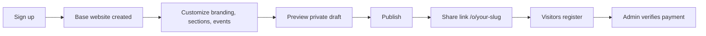
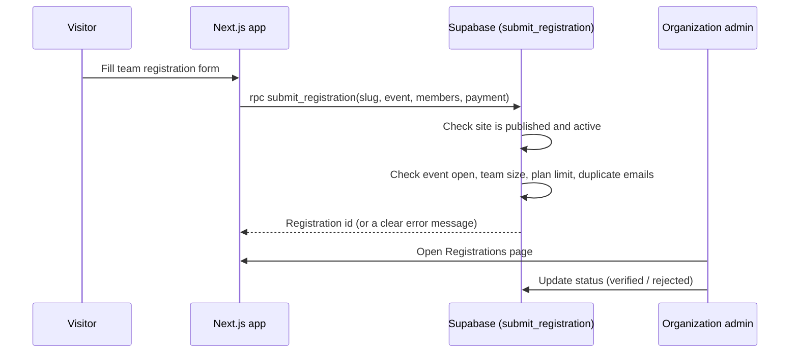
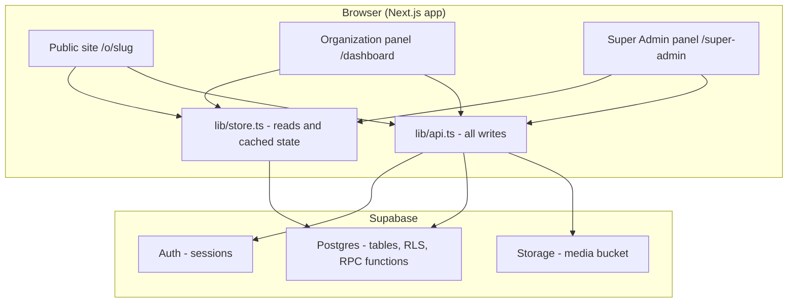
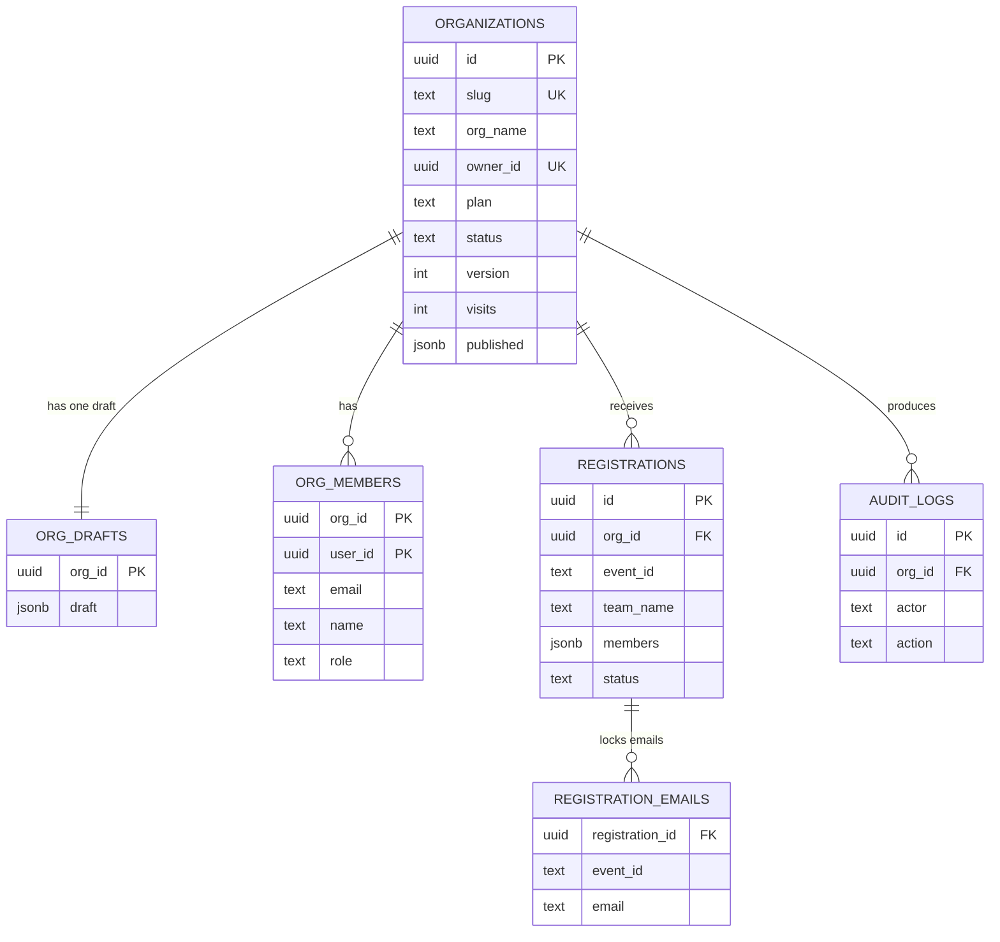

# EventForge

### Multi-Tenant, White-Label Competition & Event Management Platform

Launch your own branded event website in minutes. Customize it, preview it, publish it, and manage registrations from one dashboard.

[](https://eventforge-pi.vercel.app/)


**Live website: [https://eventforge-pi.vercel.app/](https://eventforge-pi.vercel.app/)**

</div>

---

## Table of Contents

1. [About the Project](#about-the-project)
2. [Screenshots](#screenshots)
3. [Key Features](#key-features)
4. [How It Works](#how-it-works)
5. [User Roles](#user-roles)
6. [Tech Stack](#tech-stack)
7. [System Architecture](#system-architecture)
8. [Database Design](#database-design)
9. [Security and Tenant Isolation](#security-and-tenant-isolation)
10. [Project Structure](#project-structure)
11. [Getting Started](#getting-started)
12. [Environment Variables](#environment-variables)
13. [Server Functions (RPC)](#server-functions-rpc)
14. [Application Routes](#application-routes)
15. [Testing Checklist](#testing-checklist)
16. [Deployment](#deployment)
17. [Troubleshooting](#troubleshooting)
18. [Roadmap](#roadmap)
19. [Team](#team)
20. [Contributing](#contributing)
21. [License](#license)

---

## About the Project

University clubs, tech communities and organizations keep rebuilding near-identical websites for hackathons, project showcases, workshops and competitions. Each rebuild needs a developer, and the content, schedules and prices are usually hard-coded.

**EventForge** solves this. It is a centralized **multi-tenant SaaS platform** where any organization can:

- start from a complete, ready-made event website,
- replace the sample content with its own through simple forms and image uploads,
- preview the result on a private draft,
- publish it and receive a shareable link, and
- manage events and team registrations from its own admin panel.

The platform owner uses a separate **Super Admin** panel to monitor and control every organization. **No organization can access another organization's data.**

### Problems it solves

| Problem | EventForge solution |
|---|---|
| A developer is needed for every event website | Ready-made base site edited through forms |
| Registration, payments and event pages live in separate tools | One dashboard for site, events and registrations |
| Data of many organizations on one platform is a security risk | Row Level Security enforced inside the database |
| Event code is hard-coded and not reusable | All content is data owned by the organization |

---

## Screenshots

> Add your screenshots to a `docs/` folder and update the file names below.

| Home page | Organization dashboard |
|---|---|
|  |  |

| Website builder | Public event site |
|---|---|
|  |  |

| Registrations | Super Admin panel |
|---|---|
|  |  |

---

## Key Features

### For Organizations (Admin Dashboard)

| Module | What you can do |
|---|---|
| **Branding** | Logo, organization name, tagline, announcement bar, colors, fonts, corner style, light/dark mode, with a live preview |
| **Website Builder** | Show, hide, reorder, add and delete sections (Hero, About, Events, Schedule, Speakers, Workshop, Sponsors, Partners, Venue, Previous Editions, Gallery, FAQ, Contact, Call to Action, Text). Every section has a schema-driven form and live preview |
| **Footer and SEO** | Footer text, contact details, social links, page title and description |
| **Events** | Create, duplicate, edit and delete events with prizes, fees, eligibility, team size, perks, process and resources |
| **Registrations** | View, search and filter registrations, verify or reject payments, delete entries, export to CSV |
| **Publish** | Draft and published versions are separate. Publish with one click, take the site offline, change the site address |
| **Image Upload** | Images are compressed in the browser and stored in Supabase Storage |

### For Visitors (Public Site)

- Branded public website at `/o/<your-site-address>`
- Event detail pages with countdown, prizes, process and resources
- Team registration form with member details and manual payment information (bKash and similar methods)
- Fully responsive design

### For the Platform Owner (Super Admin)

- Platform KPIs: organizations, published sites, suspended sites, events, registrations, site visits
- Organization list with plan control (Free, Pro, Enterprise), suspend or activate, and delete
- Append-only activity log (sign-ins, publishes, plan changes, suspensions)
- Sees usage and status only, never an organization's private content

### Plan Limits (enforced on the server)

| Plan | Events | Registrations |
|---|---|---|
| Free | 3 | 100 |
| Pro | 20 | 2,000 |
| Enterprise | 999 | 100,000 |

---

## How It Works



### Registration flow



---

## User Roles

| Role | Access |
|---|---|
| **Visitor** | View published sites, register for events |
| **Organization Admin** | Manage their own organization's site, events and registrations |
| **Super Admin** | Manage all organizations (status, plan, deletion) and view the activity log |

---

## Tech Stack

| Layer | Technology |
|---|---|
| Frontend | Next.js 15 (App Router), React 19, TypeScript, Tailwind CSS 3, Lucide Icons |
| Backend | Supabase (PostgreSQL, Row Level Security, RPC functions) |
| Authentication | Supabase Auth (email and password) |
| File Storage | Supabase Storage (`media` bucket) |
| Hosting | Vercel (frontend), Supabase Cloud (backend) |

---

## System Architecture



### Design decisions

- **Draft and published are separate snapshots.** Publishing copies the draft atomically inside the database.
- **The browser never decides the tenant.** The organization is found from the signed-in user on the server side.
- **Business rules live in the database** (plan quotas, duplicate-email checks, atomic registration capacity, validation), so they cannot be bypassed from the browser.
- **The UI talks to only two files**, `api.ts` for writes and `store.ts` for reads, which keeps the backend replaceable.

---

## Database Design



| Table | Purpose |
|---|---|
| `organizations` | One row per tenant: slug, name, plan, status, version, visits, published snapshot |
| `org_members` | Organization owner details (name, email, role) |
| `org_drafts` | Private draft snapshot (site settings, sections, events) |
| `registrations` | Team registrations with members and payment details |
| `registration_emails` | Guarantees one email per event, safe under concurrent requests |
| `audit_logs` | Append-only activity log |
| `platform_admins` | Users with Super Admin access |

---

## Security and Tenant Isolation

- **Row Level Security (RLS)** is enabled on every table.
- Clients **cannot insert, update or delete** directly on core tables. Changes go through `SECURITY DEFINER` RPC functions that validate input.
- Registrations (personal data) are readable only by the owning organization. Visitors can only submit through a validated function.
- The audit log is **append-only** and written only by server functions. Clients cannot forge entries.
- Organization admins can change only the `status` column of a registration.
- Storage uploads are restricted to the owner's own folder and to image types only (JPEG, PNG, WebP, GIF), 5 MB maximum. SVG is blocked.
- Super Admin actions (suspend, plan change, delete) are checked on the server with `is_super()`.
- The `service_role` key is never used in the frontend.

> The dashboard route guards in the browser are only for user experience. Real protection is enforced by the database.

---

## Project Structure

```
eventforge/
├── supabase/
│   └── schema.sql              # Tables, RLS policies, RPC functions, storage rules
├── docs/                       # Screenshots for this README
├── src/
│   ├── app/
│   │   ├── page.tsx            # Platform home page
│   │   ├── login/              # Organization login
│   │   ├── signup/             # Organization sign-up
│   │   ├── dashboard/          # Organization admin panel
│   │   │   ├── branding/
│   │   │   ├── website/        # Section builder
│   │   │   ├── events/
│   │   │   ├── registrations/
│   │   │   └── publish/
│   │   ├── super-admin/        # Platform owner panel
│   │   │   ├── organizations/
│   │   │   └── activity/
│   │   └── o/[slug]/           # Published organization site
│   │       ├── events/[eventSlug]/
│   │       └── register/[eventSlug]/
│   ├── components/
│   │   ├── site/               # Public site: navbar, footer, sections, event pages
│   │   ├── form/               # Schema-driven form engine, image upload
│   │   ├── panel/              # Dashboard shell and route guard
│   │   └── ui.tsx              # Shared UI components
│   └── lib/
│       ├── supabase.ts         # Supabase client
│       ├── store.ts            # Reads and cached state (hooks)
│       ├── api.ts              # All writes (auth, site, events, registrations, admin)
│       ├── schemas.ts          # Form definitions for every section and event field
│       ├── seed.ts             # Base website template for new organizations
│       ├── types.ts            # Data model
│       ├── theme.ts            # Theme tokens
│       └── utils.ts            # Helpers (slugs, CSV, image compression)
├── .env.local                  # Your secrets (not committed)
├── package.json
└── README.md
```

---

## Getting Started

### Prerequisites

- **Node.js 18.18 or newer**
- A free **[Supabase](https://supabase.com)** account
- **Git**

### 1. Clone the repository

```bash
git clone https://github.com/<your-username>/<your-repo>.git
cd <your-repo>
```

### 2. Install dependencies

```bash
npm install
```

### 3. Create a Supabase project

1. Create a new project on Supabase.
2. Go to **Project Settings → API** and copy the **Project URL** and the **anon / publishable key**.
3. Go to **Authentication → Sign In / Providers → Email** and turn **Confirm email OFF** while developing.

### 4. Set up the database

1. Open **Supabase → SQL Editor → New query**.
2. Paste the full content of [`supabase/schema.sql`](supabase/schema.sql) and click **Run**.

This creates all tables, security policies, server functions and the `media` storage bucket.

### 5. Add environment variables

Create a `.env.local` file in the project root:

```env
NEXT_PUBLIC_SUPABASE_URL=https://YOUR-PROJECT.supabase.co
NEXT_PUBLIC_SUPABASE_ANON_KEY=your-anon-or-publishable-key
```

### 6. Create the Super Admin account

1. In Supabase go to **Authentication → Users → Add user**, enter an email and password, and tick **Auto Confirm User**.
2. Run this in the SQL Editor (replace the email):

```sql
insert into public.platform_admins(user_id)
select id from auth.users where email = 'your-email@example.com';
```

### 7. Run the app

```bash
npm run dev
```

Open [http://localhost:3000](http://localhost:3000).

### Available scripts

| Command | Description |
|---|---|
| `npm run dev` | Start the development server |
| `npm run build` | Create a production build |
| `npm run start` | Run the production build |
| `npx tsc --noEmit` | Type-check the project |

---


## Server Functions (RPC)

| Function | Who can call | What it does |
|---|---|---|
| `is_slug_available` | Anyone | Checks format, reserved words and uniqueness of a site address |
| `create_organization` | Signed-in user | Creates the organization, owner record and base draft |
| `save_draft` | Organization admin | Validates and saves the draft, enforces plan event limit |
| `publish_site` | Organization admin | Copies the draft to the published snapshot and bumps the version |
| `unpublish_site` | Organization admin | Takes the site offline |
| `change_slug` | Organization admin | Changes the site address |
| `submit_registration` | Anyone | Validates and stores a team registration (atomic capacity and duplicate check) |
| `track_visit` | Anyone | Counts a visit on a published site |
| `log_login` | Signed-in user | Writes a sign-in entry to the audit log |
| `admin_overview` | Super Admin | Returns per-organization usage counts |
| `admin_set_status` | Super Admin | Suspend or activate an organization |
| `admin_set_plan` | Super Admin | Change an organization's plan |
| `admin_delete_org` | Super Admin | Delete an organization and its owner account |

---

## Application Routes

| Route | Who | Description |
|---|---|---|
| `/` | Everyone | Platform home page |
| `/signup` | Everyone | Create an organization and its base website |
| `/login` | Organization admin | Sign in |
| `/dashboard` | Organization admin | Overview |
| `/dashboard/branding` | Organization admin | Logo, colors, fonts, theme |
| `/dashboard/website` | Organization admin | Section builder |
| `/dashboard/events` | Organization admin | Manage events |
| `/dashboard/registrations` | Organization admin | Verify payments, export CSV |
| `/dashboard/publish` | Organization admin | Publish, unpublish, change site address |
| `/o/<slug>` | Everyone | Published organization site |
| `/o/<slug>?preview=1` | Owner only | Private draft preview |
| `/o/<slug>/events/<eventSlug>` | Everyone | Event details |
| `/o/<slug>/register/<eventSlug>` | Everyone | Registration form |
| `/super-admin/login` | Super Admin | Sign in |
| `/super-admin` | Super Admin | Platform KPIs |
| `/super-admin/organizations` | Super Admin | Manage organizations |
| `/super-admin/activity` | Super Admin | Activity log |

---

## Testing Checklist

Use this list to verify a fresh setup.

- [ ] **Sign up:** create Organization A at `/signup` and land on `/dashboard`
- [ ] **Edit:** change branding, edit a section, upload an image, create an event, then refresh and confirm everything persists
- [ ] **Publish:** publish, then open `/o/<slug>` in a private window and confirm the site loads
- [ ] **Preview protection:** `?preview=1` in the private window shows "Sign in to preview"
- [ ] **Register:** submit a registration from the public site; the same email again must be rejected
- [ ] **Verify:** verify and reject registrations in the dashboard; export CSV
- [ ] **Isolation:** create Organization B and confirm it cannot see anything from Organization A
- [ ] **Super Admin:** sign in at `/super-admin/login`, suspend Organization A, confirm its public site and login are blocked, then activate it again
- [ ] **Plan limit:** on the Free plan, creating a 4th event must fail

---

## Deployment

The project is deployed on **Vercel** with **Supabase** as the backend.

1. Push the repository to GitHub.
2. Import it on [Vercel](https://vercel.com).
3. Add the two environment variables from the section above.
4. Deploy.
5. In Supabase go to **Authentication → URL Configuration** and set **Site URL** to your Vercel URL.

**Live:** [https://eventforge-pi.vercel.app/](https://eventforge-pi.vercel.app/)

---

## Troubleshooting

| Problem | Cause | Fix |
|---|---|---|
| `Invalid API key` or `Failed to fetch` | Wrong `.env.local` values or server not restarted | Re-copy URL and key, then restart `npm run dev` |
| Sign-up says "Email confirmation is ON" | Supabase email confirmation enabled | Turn off **Confirm email** for development |
| `permission denied for table ...` | Database setup incomplete | Run the full `supabase/schema.sql` again |
| `function ... does not exist` | A server function was not created | Re-run the SQL and check the editor for errors |
| `Please sign in again.` | Session expired | Sign out and sign in again |
| Dashboard shows an endless spinner | Data load failed | Open the browser console (F12) and check the error |
| Image upload fails | Not signed in, wrong type or over 5 MB | Use JPG, PNG or WebP under 5 MB |

---

## Roadmap

Completed:

- [x] Organization sign-up and login
- [x] Branding, website section builder, draft and publish workflow
- [x] Events and team registration with payment verification
- [x] Super Admin panel with activity log
- [x] Supabase backend with tenant isolation (RLS) and server-side plan limits

Planned:

- [ ] Judging (magic-link judges, rubrics, blind scoring) and leaderboards
- [ ] Coupons, QR check-in and volunteer scanner
- [ ] Seat assignment and certificates
- [ ] Broadcast email and analytics
- [ ] **Smart Team Matching:** skill-complementary, explainable team suggestions for solo participants
- [ ] **Automated Submission Check:** advisory integrity report for code submissions
- [ ] Rate limiting, email verification and multi-factor authentication
- [ ] Custom domains, static export and self-hosting

---

## Team

| Name | Role |
|---|---|
| **Md Jitu Mia** | Full-stack developer (frontend and backend) |
| **Saida Islam** | Full-stack developer (frontend and backend) |

Both members worked together on the frontend and the backend of this project.

Daffodil International University, Department of Software Engineering.

---

## Contributing

1. Fork the repository and create a branch: `git checkout -b feature/your-feature`
2. Make your changes and run `npx tsc --noEmit` to check types
3. Commit with a clear message: `git commit -m "Add: short description"`
4. Push and open a Pull Request

---

## License

This project was developed for academic purposes. Add a license of your choice (for example MIT) before reusing it publicly.

---

<div align="center">

**EventForge** · Built by Md Jitu Mia and Saida Islam · [Live Website](https://eventforge-pi.vercel.app/)

</div>
